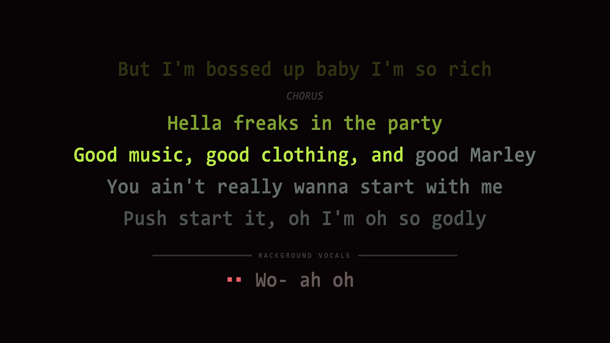
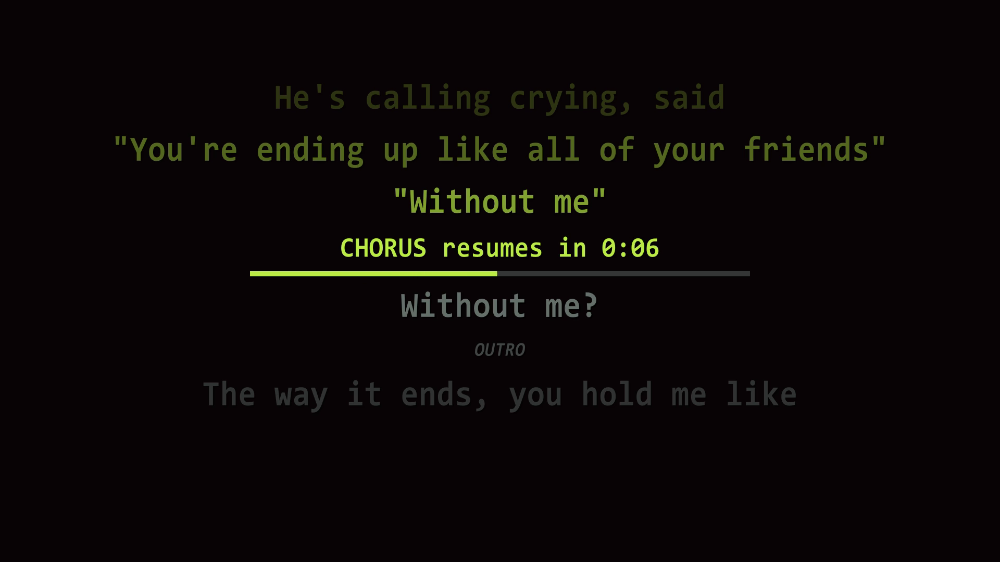

# bayshore-trap-karaoke

A pipeline that turns a YouTube link and a lyrics sheet into a finished karaoke video: separated instrumental, word-timed scrolling lyrics, title cards, and ready-to-paste YouTube listing copy.

It was built for **[bayshore trap karaoke](https://youtube.com/@bayshoretrap)**, a channel making karaoke videos for indie, underground and niche tracks that other karaoke channels don't cover.

| [](https://youtu.be/mL6LqMbBR7k) | [](https://youtu.be/iaCOTTO11eY) |
|---|---|
| **smokedope2016, "In Da Party"**: dense rap, with the syllable sweep mid-line, a section label and a background-vocal line with its entry cue. | **Jane Remover, "Census Designated"**: a countdown and progress bar through an instrumental break, with the stack still visible. |

Click either image to watch the video.

## What it does

- **Separates the vocals** from the original track with an ensemble of two models (MelBand Roformer and Demucs htdemucs_ft), averaged.
- **Aligns the lyrics to the vocals** with WhisperX, then converts the result into an `.ass` subtitle file with per-syllable karaoke timing.
- **Makes the human timing pass fast.** A browser tool lets you tap along to the song, one key press per syllable, and exports corrected timing. A finished track takes about ten minutes instead of the 90 to 120 a manual pass in Aegisub used to take. An export check catches structural problems (lines parked on a placeholder time, lines out of order, lines too short) before the file goes any further.
- **Lays out the lyrics** with an Aegisub macro: a seven-line scrolling stack with the active line in the middle, section labels from the lyric sheet's `[Verse]` / `[Chorus]` headers, countdowns through instrumental breaks and the outro, a separate zone for background vocals, and cue dots before each entry.
- **Renders and assembles** the karaoke video at 60fps, generates front and end title cards, splices them together, and writes the YouTube title, description, tags and thumbnail.

## How it fits together


`run_pipeline.py` runs every step in order and pauses for the two manual ones. It can resume from any step with `--from-step N`.

<details>
<summary>Which script runs each step</summary>

| Step | Script | What happens |
|---|---|---|
| 0 | `initialize_track.py` | Creates the track folder, asks for the track's details, creates an empty lyrics file, downloads the audio |
| | *you* | Paste the lyrics into `_lyr.txt` |
| 1 | `run_stems.py` | Separates vocals and instrumental |
| 2 | `run_whisperx.py` | Aligns the lyrics to the vocal stem |
| 3 | `whisperx_to_ass.py` | Writes `_subs.ass` with per-syllable timing |
| | *you* | Tap tool, export check, then Aegisub: fix-ups, styles, run the macro once |
| 4 | `render_titles.py` | Front and end title cards |
| 5 | `karaoke_render.py` | The karaoke video |
| 6 | `splice_titles.py` | Title cards and karaoke video joined into the final video |
| 7 | `generate_yt.py` | YouTube listing copy and thumbnail |

</details>

## Requirements

- **Windows.** The pipeline uses Consolas and Segoe UI Symbol, which ship with Windows, and has only been run there.
- **Python 3.11** for two virtual environments (one for stem separation, one for WhisperX), plus Python 3.11 or later to run the pipeline itself.
- **An NVIDIA GPU with CUDA.** WhisperX is run in its default GPU mode, and stem separation on a CPU takes many times longer.
- **ffmpeg** built with libass (the gyan.dev "full" build works).
- **Aegisub 3.4**.
- **yt-dlp** installed with `yt-dlp[default]`, and **Deno**, which yt-dlp needs to download from YouTube.

## Quick start

The full walkthrough, including the two virtual environments, Aegisub setup and the tap tool, is in **[HOWTO.md](HOWTO.md)**. In short:

1. Clone the repository and create the two virtual environments from `requirements-stems.txt` and `requirements-karaoke.txt`.
2. Copy `config.example.toml` to `config.toml` and set the paths to your two virtual environments, and to wherever you want track folders kept.
3. Copy **only** `aegisub/btk_karaoke_v2.lua` into Aegisub's `automation/autoload` folder. Aegisub loads every `.lua` file it finds there, so copying the whole repository in would load files that are not macros. Then put the lyric styles from `aegisub/btk_styles.ass` into Aegisub's style storage (HOWTO, section 5).
4. Start a track:

   ```powershell
   cd scripts
   py run_pipeline.py artist_track-name https://youtube.com/watch?v=...
   ```

## Repository layout

```
scripts/                Python pipeline, one script per step, plus run_pipeline.py
aegisub/                btk_karaoke_v2.lua, the Aegisub macro, and btk_styles.ass, the lyric styles
tools/tap_timing/       btk_tap.html, the tap-timing tool (open it in a browser)
docs/                   pipeline-flow.mmd, the source of the flow chart
docs/images/            the rendered flow chart and the README screenshots
config.example.toml     settings template; copy to config.toml
```

Each track gets its own folder (`tracks/<track_id>/` by default), holding every intermediate file under the track's ID: `_original.wav`, `_vox.wav`, `_inst.wav`, `_lyr.txt`, `_subs.ass`, `_subs-tap.ass`, `_subs-timed.ass`, `_subs-final.ass`, and the rendered videos.

## The tap tool on its own

`tools/tap_timing/btk_tap.html` is a single self-contained file with nothing to install. Open it in a browser, load an `.ass` file with karaoke tags and the matching audio, and tap along with J and K. It is built around the files this pipeline produces; other karaoke `.ass` files with `\k` tags may load too, but have not been tested.

## Content

No lyrics, timing files or audio are included. The songs belong to their artists; this repository contains only the tools.

## Credits and licence

Created by Andy Charlie W. ([ambilixer](https://github.com/ambilixer)) in collaboration with Claude (Anthropic).

Released under the MIT licence; see [LICENSE](LICENSE).
